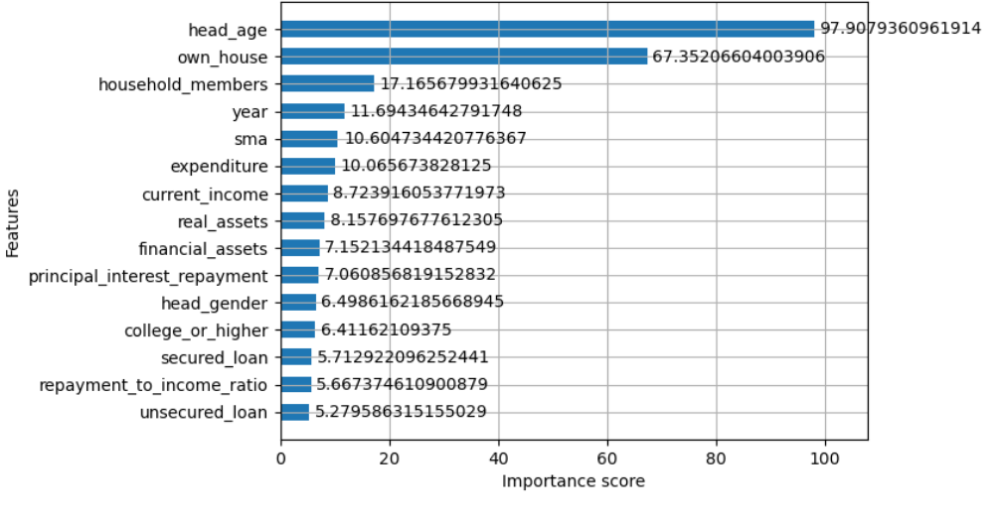
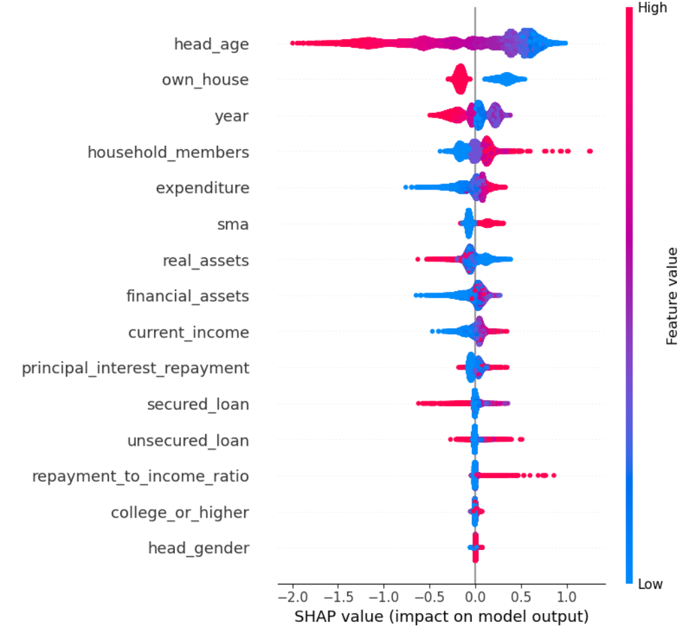

# Real Estate Investment | 다년도 가구 데이터 기반 투자 의사결정 분석

**2019–2025년 가구 조사 자료를 통합하고 XGBoost 분류·SHAP 분석으로 부동산 투자 의향 관련 예측 요인 탐색**

## 문제 정의
- **예측 대상:** `investment_decision` (부동산 투자 의향 분류)
- **데이터:** 2019–2025년 가구 조사 자료
- **주요 기술:** 데이터 통합, XGBoost, Feature Importance, SHAP

## 주요 구현
- **다년도 데이터 통합:** 연도별 상이한 컬럼명·변수 코드 정리 및 공통 특징 체계 구성
- **전처리:** 연령, 주택 소유, 자산·부채·소득·지출 변수 정제 및 특성 구성
- **분류 모델:** `XGBClassifier` 학습, 계층화 무작위 80:20 분할로 성능 평가
- **모델 해석:** Feature Importance 및 SHAP TreeExplainer로 변수별 예측 기여도·방향 확인

## 모델 평가

| 지표 | 무작위 홀드아웃 결과 |
|---|---:|
| Accuracy | 0.6830 |
| F1-score | **0.6816** |
| ROC-AUC | **0.7443** |

- **평가 조건:** `train_test_split(test_size=0.2, stratify=y, random_state=42)`
- **해석 범위:** 연도별 미래 예측 검증이 아닌, 통합 데이터의 무작위 분할 평가

## 분석 결과
- 연도별 가구 자료의 변수 구조를 통일해 단일 분류 데이터셋 구성
- 연령·주택 소유 여부·조사 연도 등 주요 특징에 대한 SHAP 기여도 확인

## 코드
| Notebook | 내용 |
|---|---|
| [01_Data_Analysis](./01_Data_Analysis.ipynb) | 다년도 자료 정제·통합 및 EDA |
| [02_Final_XGBoost_Model](./02_Final_XGBoost_Model.ipynb) | XGBoost 학습·홀드아웃 평가, SHAP 분석 |

