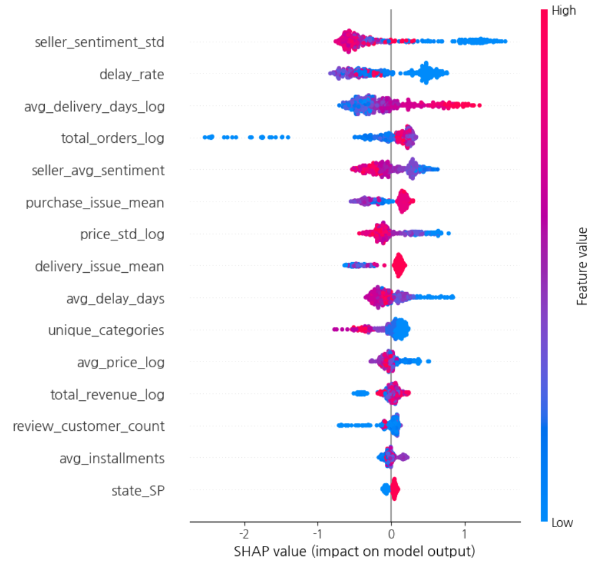

# Olist E-commerce | Transformer NLP & PyTorch MLP 기반 셀러 이탈 분석

> **핵심:** Olist 다중 거래 테이블과 리뷰 텍스트 결합. 사전학습 Transformer 감성 추론, PyTorch MLP 직접 학습, 트리 앙상블 비교 및 SHAP 분석

## 문제 정의
- 브라질 E-commerce 플랫폼 Olist의 고객·주문·상품·판매자 데이터를 이용해 **셀러 이탈을 예측**하고, 어떤 판매·배송·고객경험 특성이 이탈 예측과 연관되는지 분석함
-거래만 활용하는 모델에서 출발해 **리뷰 텍스트 기반 표현**을 추가하고, 트리 기반 학습과 신경망 모델을 같은 과제에서 비교함

## Dataset & Data Pipeline
- *Brazilian E-Commerce Public Dataset by Olist*: `customers`, `orders`, `order_items`, `payments`, `products`, `reviews`, `sellers` 등
- `customer_id` / `order_id` / `seller_id` / `product_id`를 기준으로 데이터를 연결
- 주문당 여러 품목·결제가 존재할 수 있으므로 **주문 단위 선집계** 후 병합하는 방식을 활용
- 고객 분석에서 RFM(Recency·Frequency·Monetary)과 배송 지연·구매 패턴 비교
- 셀러 단위 거래량·매출·판매가격·평균 배송일·배송 지연 비율·리뷰 감성 통계량 생성. 거래 기록을 기반으로 셀러 이탈 라벨 구성

## 핵심 구현 1 — 사전학습 Transformer 기반 리뷰 분석
`02_Customer_Analysis.ipynb`에서 Hugging Face `transformers`의 `AutoTokenizer`, `AutoModelForSequenceClassification`, `pipeline`을 사용함

```python
model_name = "cardiffnlp/twitter-xlm-roberta-base-sentiment"
tokenizer = AutoTokenizer.from_pretrained(model_name)
model = AutoModelForSequenceClassification.from_pretrained(model_name, use_safetensors=True)
# pipeline("sentiment-analysis", model=model, tokenizer=tokenizer, ...)
```

- 텍스트를 전처리하고 **128개 단위 배치 추론**, `max_length=128`을 적용
- 각 리뷰에서 `sentiment_label`, `sentiment_score`를 추출해 주문 데이터에 연결
- 감성 평균뿐 아니라 **셀러별 감성 변동성** 등 통계량으로 변환해 비정형 텍스트를 정형 예측 변수로 활용
- **분석 결과 활용:** 사전학습 모델의 리뷰별 감성 추론 결과를 주문·셀러 데이터에 연결. 별도 신경망 파인튜닝 없이 추론값을 특성으로 활용
- 리뷰 주제 탐색은 별도로 **LDA 토픽 모델링**을 실험

## 핵심 구현 2 — PyTorch MLP 직접 설계 및 반복 실험
`03_Seller_Analysis.ipynb`에서 신경망을 구성하고 트리 기반 분류기와 비교함

```text
입력 특징량
  ↓ StandardScaler
Linear(input_dim, 64) → ReLU → Dropout(0.3)
  ↓
Linear(64, 32) → ReLU → Dropout(0.3)
  ↓
Linear(32, 1) → BCEWithLogitsLoss
  ↓ Sigmoid
이탈 확률 / 분류 임계값 0.5
```

- **학습:** Adam(`lr=0.001`, `weight_decay=1e-4`), 최대 200 epoch, 검증 손실 기반 Early Stopping(`patience=15`).
- **검증:** 훈련 데이터에서 별도 검증셋 15%를 분리
- **반복 학습:** 시드 `0, 1, 2, 3, 4`로 5차례 재학습하고 F1·ROC-AUC의 평균·표준편차 계산
- **비교 모델:** XGBoost, LightGBM에 Optuna 기반 탐색, 확률 보정(`CalibratedClassifierCV`), 예측확률 앙상블, 분류 임계값 탐색을 적용

## 실험 및 분석 결과

- **트리 앙상블과 MLP 비교:** XGBoost·LightGBM과 직접 구현한 MLP를 동일한 셀러 이탈 분류 과제에 적용. 노트북 실험에서 트리 앙상블의 F1 우위 확인
- **학습 안정성 실험:** MLP를 5개 초기 시드로 반복 학습하고 F1·ROC-AUC의 변동폭 분석. 단일 학습 결과에 의존하지 않는 모델 비교 방식 적용
- **확률 기반 판정 실험:** XGBoost·LightGBM의 예측 확률 보정과 임계값 조정에 따른 Precision·Recall·F1 변화 분석
- **SHAP 분석:** 셀러 거래·배송·리뷰 관련 변수가 이탈 분류 예측에 기여하는 정도 비교
- **데이터 결합 결과:** 비정형 리뷰 텍스트에서 추출한 감성 점수를 셀러별 정형 특징으로 변환하여 거래·배송 특성과 함께 모델 입력에 반영



## Notebook Guide

| 파일 | 수행 내용 |
|---|---|
| [`01_Data_Preprocessing.ipynb`](./01_Data_Preprocessing.ipynb) | 다중 테이블 병합, 주문 및 고객 데이터셋 구성 |
| [`02_Customer_Analysis.ipynb`](./02_Customer_Analysis.ipynb) | 배송 분석, Transformer 감성 추론, LDA |
| [`03_Seller_Analysis.ipynb`](./03_Seller_Analysis.ipynb) | 이탈 라벨·특징 생성, XGBoost/LightGBM, **PyTorch MLP**, Optuna, SHAP |

**Stack** `Python` `Pandas` `PyTorch` `Transformers` `Scikit-learn` `XGBoost` `LightGBM` `Optuna` `SHAP` `LDA`
